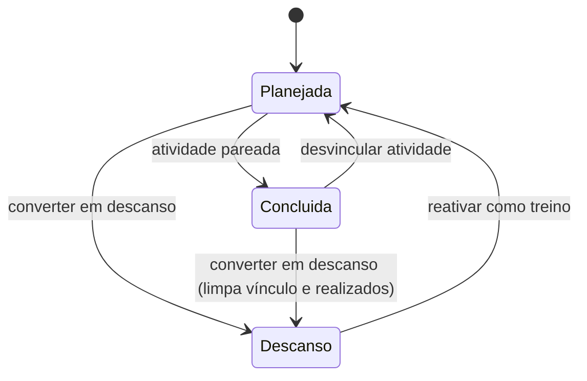

# Spec — Backend business-rule refactor

> **Status:** pronto
> **Funcionalidade:** `F01`
> **PRD:** [prd.md](./prd.md)
> **Roadmap:** [docs/roadmap.md](../../roadmap.md)
> **HLD:** [docs/hld.md](../../hld.md)
> **LLD:** [docs/lld.md](../../lld.md)
> **ADRs:** [ADR-0001](../../adr/0001-technical-enabler-with-frozen-contract.md),
> [ADR-0002](../../adr/0002-ai-annotations-are-not-plan-changes.md)

---

## 1. Objetivo técnico

Fazer as regras que o produto já declara valerem em todos os caminhos que as alcançam: a edição de
sessão e de semana passa a aplicar os mesmos limites da geração, a sessão de descanso deixa de
poder aparecer concluída, a ingestão de atividade não alcança dados de outro atleta, a semana da
análise passa a ser uma só e a recusa chega à tela com o motivo. O contrato de API e as telas
continuam os mesmos, como registra a [ADR-0001](../../adr/0001-technical-enabler-with-frozen-contract.md);
o que o atleta percebe está no [PRD](./prd.md), §3 e §5.

O trabalho estrutural necessário (helpers compartilhados, transação, função pura de anotação) fica
nesta spec; nenhuma rota, campo ou tela nova é criada.

---

## 2. Decisões de implementação

### 2.1 Contrato congelado, com uma única exceção de leitura

Nenhuma rota, nome de campo ou formato de resposta muda. A única mudança visível é que o frontend
passa a ler o corpo de erro que o backend **já devolve** (`code` e `message`) e a exibir o motivo
em pt-BR. Origem: [ADR-0001](../../adr/0001-technical-enabler-with-frozen-contract.md), `HLD §8 —
Superfície da API` (tabela inalterada) e `LLD §2 — Convenções transversais` (o client atual propaga
apenas `status` e `message`).

Consequência: não há rota, coluna, campo ou migration nova nesta funcionalidade — o
`plannedWeeklyKm` já existe e só passa a ter uma semântica única.

### 2.2 Total planejado da semana tem uma fonte única no servidor

`training_plans.plannedWeeklyKm` passa a ser o único total planejado: soma das distâncias
planejadas das sessões que não são de descanso, **em metros** (o nome da coluna é legado; o ajuste
de volume já a consome em metros). Ele é recalculado em toda edição aceita (individual ou em lote)
e depois do ajuste de volume por excesso, e é normalizado na leitura para planos antigos.

O dashboard e o cabeçalho da semana no plano exibem esse campo, em vez de cada tela somar as sessões
por conta própria; o realizado continua vindo de `/analytics/weekly` e rotulado como realizado.
Origem: `LLD §8.1 — Endpoints`, `LLD §8.10 — Ajuste de volume por excesso`,
`LLD §17.6 — Páginas e dados`, PRD §5 critério 9.

### 2.3 Edição transacional com trava na linha do plano

As duas rotas de edição (`PUT .../sessions/:sessionId` e `PUT .../sessions/batch`) passam a rodar
em transação, travando a linha de `training_plans` (`pessimistic_write`) antes de ler as sessões,
validar e gravar. Duas edições concorrentes no mesmo plano são serializadas; a segunda enxerga o
estado da primeira e não deixa duas sessões no mesmo dia. A ordem de aquisição é sempre plano →
sessões, para não criar deadlock.

Isso atende ao critério 12 sem índice único e sem migration, que continuam com a feature de
migrations (PRD §6). Origem: `HLD §9 — Invariantes arquiteturais`, item 3; `LLD §8.8 — Edição de
sessão`.

### 2.4 Limites de idade na edição: distância, volume semanal e qualidade

A edição aplica, no servidor, o mesmo ajuste de idade da geração (`LLD §13.2 — Ajustes de plano`):

| Limite | Regra na edição | Bloqueio |
|---|---|---|
| Distância da sessão | `assessDistanceForAge` + `maxLongRunKm` | `AGE_POLICY`, aceito com `acknowledgeAgePolicy` (comportamento atual) |
| Volume semanal | soma das distâncias planejadas das sessões não-descanso, no estado final, contra `maxWeeklyKm` | `AGE_POLICY`, sem sobreposição |
| Qualidade semanal | contagem de sessões `interval`, `tempo` e `fartlek` no estado final, contra `maxQualitySessions` | `AGE_POLICY`, sem sobreposição |

Só valem limites **absolutos**: `maxWeeklyKm` existe nas faixas até 17 anos e `maxQualitySessions`
existe até 17 e em 60+. O `volumeFactor` de 60+ continua sendo aplicado só na geração; a edição não
inventa um teto relativo que o documento não define. Sem `birthDate`, nenhum limite de idade é
aplicado, como hoje.

O bloqueio de volume e qualidade é duro: `acknowledgeAgePolicy` continua valendo apenas para a
distância. A ordem das validações no estado final é: dono da sessão, distância por idade, dia único,
volume semanal e qualidade. Origem: `HLD §9 — Invariantes arquiteturais`, item 8;
`LLD §8.8 — Edição de sessão`; `LLD §13.2 — Ajustes de plano`; PRD §5 critérios 2–4.

### 2.5 Sessão de descanso nunca é concluída e nunca recebe atividade

A conversão de uma sessão em descanso, em qualquer caminho, zera distância e pace **e** limpa
`completed`, `activityId`, `actualDistance`, `actualPace`, `actualMovingTime`, `matchScore`,
`matchMethod` e `matchedAt`. O vínculo manual de uma atividade a uma sessão de descanso é recusado
com `REST_SESSION`; o pareamento automático já ignora descanso e passa a ter uma guarda também no
ponto que grava o vínculo.

Planos antigos são normalizados na leitura: uma sessão de descanso sai sempre com
`completed = false`, distância/pace zero e realizados nulos. Isso corrige a exibição de planos já
gravados, sem script nem migration; dias duplicados legados não são resolvidos automaticamente,
porque não há como escolher qual sessão preservar sem perder dado. Origem:
`HLD §9 — Invariantes arquiteturais`, item 4; `LLD §8.8 — Edição de sessão`;
`LLD §8.9 — Pareamento de atividades`; PRD §5 critérios 5 e 6.

### 2.6 Ingestão e pareamento escopados pelo dono

O webhook resolve a atividade pelo par `activityStravaId` **e** dono (`owner_id` → usuário), tanto
na exclusão quanto no upsert. Um evento cujo dono não corresponde à atividade não altera nada:
não desvincula sessão, não apaga atividade e não atualiza registro alheio. O desvínculo em cascata
também é escopado pelo plano do atleta.

O `RUN_SPORTS` deixa de viver só no webhook e passa a ser uma constante compartilhada de
`veltra-backend`, reutilizada pela análise semanal. Origem: `HLD §9 — Invariantes arquiteturais`,
itens 1 e 5; `LLD §6.2 — ActivitiesService`; `LLD §7.3 — Webhook`; PRD §5 critérios 7 e 11.

### 2.7 Semana da análise: uma janela, um conjunto

`GET /analytics/weekly` passa a considerar a semana atual de segunda a domingo **no horário local
do servidor** (a definição do `HLD §9`, item 6, e do `LLD §14 — Analytics`), com intervalo
semiaberto `[segunda 00:00, segunda seguinte 00:00)` e apenas corridas do atleta — `Run`,
`TrailRun` e `VirtualRun`, o mesmo conjunto da ingestão. A corrida exatamente na virada pertence a
uma única semana.

A janela continua construída sobre `start_date` (instante UTC) comparado aos limites locais do
servidor; `start_date_local` não é usado porque é o horário local do Strava, não o do servidor, e
porque a sincronização de login não o grava de forma confiável. Origem:
`HLD §9 — Invariantes arquiteturais`, item 6; `LLD §14 — Analytics`; PRD §5 critério 8.

### 2.8 A recusa chega à tela com o motivo

O client HTTP lê o corpo JSON do erro uma única vez e propaga `{ status, message, code }`; quando
o corpo não é JSON, mantém o fallback atual. `updateSession`, `applySessionChange` e
`applySessionsBatch` devolvem o `message` do servidor (pt-BR), e a página do plano e o chat do coach
o exibem. Não há componente novo: a mensagem aparece no próprio cartão da sessão ou no cartão da
proposta, com os tokens de erro do design system. Origem: `LLD §2 — Convenções transversais`;
`LLD §17.3 — Client HTTP`; `LLD §17.6 — Páginas e dados`; `LLD §20 — Lacunas e cuidados
conhecidos` (código de erro no frontend); PRD §3 fluxo 1 e §5 critérios 1–4.

Textos das recusas novas (pt-BR, no vocabulário do [GLOSSARY.md](../../../GLOSSARY.md)):

- Volume: “A semana ficaria com {volume} km de volume planejado; para a sua idade o limite é
  {limite} km. Reduza a distância de uma das sessões e tente de novo. Nada foi alterado.”
- Qualidade: “A semana ficaria com {quantidade} sessões de qualidade; para a sua idade o limite é
  {limite}. Transforme uma delas em treino leve ou descanso e tente de novo. Nada foi alterado.”
- Vínculo com descanso: “Sessão de descanso não recebe atividade. Escolha um treino da semana para
  vincular a corrida. Nada foi alterado.”

Os textos já existentes de `AGE_POLICY` (distância) e `DAY_COLLISION` permanecem.

### 2.9 Anotação de IA não é mudança de plano

O caminho que grava foco, notas do plano e dicas do coach passa a ser uma função pura que produz
**somente** `focus`, `coachNotes` e `notes`; o service apenas aplica o resultado. Nenhuma anotação
altera distância, pace, dia, tipo ou conclusão. Origem:
[ADR-0002](../../adr/0002-ai-annotations-are-not-plan-changes.md); `HLD §9 — Invariantes
arquiteturais`, item 7; `LLD §8.2 — Geração do plano`, passo 11.

### 2.10 Sem migration, sem entidade, sem rota

Não há entidade nova (`LLD §19.2 — Nova entidade`), rota nova (`LLD §19.1 — Novo endpoint
autenticado`) nem regra de IA nova (`LLD §19.4 — Nova regra de IA`). As mudanças são de
comportamento em código existente; os únicos arquivos novos de domínio são o construtor puro de
anotações e os helpers de estado da sessão/esportes.

---

## 3. Componentes afetados

### 3.1 `veltra-backend`

| Componente | Situação | O que muda | LLD de origem |
|---|---|---|---|
| `training-plans/training-plans.service.ts` | existe | Edição individual e em lote em transação com trava; limites de volume/qualidade; limpeza do descanso; recálculo do total; normalização na leitura | `§8.1`, `§8.2`, `§8.8` |
| `training-plans/activity-matcher.service.ts` | existe | Recusa de vínculo manual com descanso; guarda no ponto que grava vínculo; desvínculo escopado | `§8.9` |
| `training-plans/volume-adjustment.service.ts` | existe | Recalcula `plannedWeeklyKm` depois do corte | `§8.10` |
| `training-plans/training-session-state.ts` | a detalhar | Helpers puros: limpar realizados, normalizar descanso, somar volume planejado | `§8.8`, `§8.9` |
| `training-plans/plan-annotations.ts` | a detalhar | Construtor puro das anotações (foco, notas e dicas) | `§8.2`, ADR-0002 |
| `activities/activities.service.ts` | existe | `findByStravaId` e `upsert` escopados pelo dono; desvínculo por plano | `§6.2` |
| `activities/run-sports.ts` | a detalhar | Constante compartilhada de corrida | `§7.3` |
| `strava-webhook/strava-webhook.service.ts` | existe | Exclusão e upsert com dono; usa a constante compartilhada | `§7.3` |
| `analytics/analytics.service.ts` | existe | Janela semiaberta, apenas corridas, usuário | `§14` |
| `health/age-policy.ts` | existe | Ganha a avaliação pura de volume/qualidade da semana; sem mudança de contrato | `§13.2` |

### 3.2 `veltra-frontend`

| Componente | Situação | O que muda | LLD de origem |
|---|---|---|---|
| `src/lib/api/client.ts` | existe | Propaga `message` e `code` do corpo de erro | `§17.3` |
| `src/lib/api/training.ts` | existe | Devolve o resultado com o motivo do servidor em edição e lote | `§17.6` |
| `src/app/(authenticated)/training-plan/page.tsx` | existe | Exibe a recusa no cartão da sessão; cabeçalho da semana usa `plannedWeeklyKm` | `§17.6` |
| `src/app/(authenticated)/dashboard/page.tsx` | existe | Usa `plannedWeeklyKm` para o planejado; realizado continua separado | `§17.6` |
| `src/app/(authenticated)/coach/chat/page.tsx` | existe | Passa a exibir a mensagem real da recusa ao aplicar proposta | `§17.4` |

Nenhuma página, componente de `ui` ou item de sidebar novo. O roteiro de página segue o
`LLD §19.3 — Nova página no frontend`, mas não há página nova.

---

## 4. Dados

Nenhuma entidade, tabela, coluna, índice ou migration nova. Delta de semântica:

| Item | Delta | Origem |
|---|---|---|
| `training_plans.plannedWeeklyKm` | Continua existindo; passa a ser recalculado em edição e ajuste e normalizado na leitura; unidade metros | `LLD §4.1 — Entidades e colunas`, `LLD §8.10` |
| `training_sessions` | Sem coluna nova; `rest` normalizado na leitura (conclusão e realizados limpos) | `LLD §4.1`, `LLD §4.2` |
| Migrations | Nenhuma; a garantia de dia único no armazenamento segue com a feature de migrations | PRD §6, `LLD §20` |

O nome `plannedWeeklyKm` com valor em metros é legado do código atual; a spec o mantém para não
mudar contrato e manda registrar a unidade no LLD.

---

## 5. Interfaces

Nenhuma rota nova; a tabela do `HLD §8 — Superfície da API` não muda.

| Rota | Delta | Origem |
|---|---|---|
| `PUT /training-plans/:planId/sessions/:sessionId` | Mesmo body e resposta; passa a recusar volume/qualidade com `AGE_POLICY`; converte descanso limpando conclusão e realizados; roda em transação | `LLD §8.8` |
| `PUT /training-plans/:planId/sessions/batch` | Mesmo body e resposta; mesmas recusas no estado final; atômico e serializado | `LLD §8.8` |
| `PUT /training-plans/:planId/sessions/:sessionId/activity` | Recusa vínculo com descanso com `REST_SESSION` (400) | `LLD §8.9` |
| `GET /training-plans/current`, `GET /training-plans`, `GET /training-plans/by-week` | Mesmos campos; descanso normalizado e `plannedWeeklyKm` coerente | `LLD §8.1` |
| `GET /analytics/weekly` | Mesmos campos; janela semiaberta seg–dom local e apenas corridas | `LLD §14` |
| `POST /strava/webhook` | Sem mudança de contrato; processamento escopado pelo dono | `LLD §7.3` |

Client HTTP: o erro deixa de ser `{ status, message }` genérico e passa a `{ status, message, code? }`
com o texto do servidor; é comportamento do client, não contrato da API (`LLD §17.3`).

Sem evento de WebSocket e sem Server Action.

---

## 6. Estados e regras

### 6.1 Estados da sessão

`Descanso` nunca aparece em `Concluida`; a conversão a partir de `Concluida` desfaz o pareamento e
os realizados. Origem: `HLD §9`, item 4; `LLD §8.8`, `LLD §8.9`.

### 6.2 Regras

- **Dia único.** Uma sessão por dia na semana, no estado final; lote inteiro aceito ou recusado;
  edições concorrentes serializadas pela trava do plano. (`HLD §9.3`, `LLD §8.8`)
- **Descanso.** Distância e pace zero, nunca concluído, nunca recebe atividade; normalizado na
  leitura. (`HLD §9.4`, `LLD §8.8`, `LLD §8.9`)
- **Idade.** Distância por sessão (com ciência), volume semanal e qualidade (sem ciência), apenas
  limites absolutos. (`HLD §9.8`, `LLD §13.2`)
- **Pareamento.** Automático e manual ignoram/recusam descanso; exclusão no Strava desfaz só o
  vínculo do dono. (`HLD §9.1`, `HLD §9.5`, `LLD §8.9`, `LLD §7.3`)
- **Semana atual.** Segunda a domingo no horário local do servidor, intervalo semiaberto, só
  corridas do atleta. (`HLD §9.6`, `LLD §14`)
- **Total planejado.** Soma das distâncias planejadas não-descanso, em metros, recalculada em
  edição e ajuste. (`LLD §8.10`, `LLD §17.6`)
- **Anotação de IA.** Só foco, notas do plano e dicas; nunca os cinco campos de mudança.
  (`HLD §9.7`, ADR-0002)
- **Contrato.** Rotas, campos e formato iguais; `snake_case` na API e `camelCase` no client.
  (`HLD §9.9`, ADR-0001)

### 6.3 Recusas

| Código | Situação | Corpo |
|---|---|---|
| `AGE_POLICY` | Distância, volume ou qualidade acima do limite da idade | `{ code, message }` (+ campos atuais na distância) |
| `DAY_COLLISION` | Estado final com duas sessões no mesmo dia | `{ code, message }` (inalterado) |
| `REST_SESSION` | Vínculo de atividade com sessão de descanso | `{ code, message }` |

---

## 7. Decomposição em tarefas

A quebra em fatias, os bloqueios e os arquivos `tasks/<NN>-<titulo>/task.md` são da skill
`to-tasks`; esta seção registra o resultado aprovado.

| Nº | Tarefa | Resultado entregável | Depende de |
|---|---|---|---|
| `01` | [`rest-never-completed`](./tasks/01-rest-never-completed/task.md) | Descanso não conclui, não recebe atividade e é normalizado na leitura; helpers de estado e total planejado | — |
| `02` | [`age-limits-on-edit`](./tasks/02-age-limits-on-edit/task.md) | Edição individual e em lote em transação com trava, limites de volume/qualidade e total recalculado | `01` |
| `03` | [`ingestion-and-owner-matching`](./tasks/03-ingestion-and-owner-matching/task.md) | Webhook, upsert e desvínculo escopados pelo dono; constante de corrida compartilhada | — |
| `04` | [`current-week-in-analytics`](./tasks/04-current-week-in-analytics/task.md) | `/analytics/weekly` seg–dom local, semiaberto e só corridas | `03` |
| `05` | [`rejection-and-total-in-ui`](./tasks/05-rejection-and-total-in-ui/task.md) | Client propaga motivo; plano e dashboard exibem a recusa e o mesmo total planejado | `01`, `02` |
| `06` | [`ai-annotation-without-plan-change`](./tasks/06-ai-annotation-without-plan-change/task.md) | Construtor puro de anotações e teste que prova que só foco, notas e dicas mudam | — |

---

## 8. Estratégia de teste

Pontos de teste, todos no nível de service/rota existente, com um arquivo novo apenas para a
anotação:

| Ponto | Spec | Prova |
|---|---|---|
| `TrainingPlansService.updateSession` / `updateSessionsBatch` | `training-plans.service.spec.ts` | dia único, descanso limpo, volume/qualidade, total, normalização na leitura |
| `ActivityMatcherService.linkActivityToSession` | `activity-matcher.service.spec.ts` | vínculo manual com descanso recusado |
| `StravaWebhookService.handleEvent` | `strava-webhook.service.spec.ts` | exclusão/upsert só no dono; evento de outro dono não altera |
| `AnalyticsService.getWeeklyStats` | `analytics.service.spec.ts` | janela semiaberta, corridas, usuário |
| `age-policy` | `age-policy.spec.ts` | avaliação pura de volume/qualidade pelos limites absolutos da idade |
| `plan-annotations` | `plan-annotations.spec.ts` | só `focus`, `coachNotes` e `notes`; nunca os cinco campos |

Cenários de unidade:

- Converter sessão concluída em descanso limpa `completed`, vínculo e realizados; converter
  descanso em treino mantém a sessão planejada.
- Edição individual e lote recusam volume e qualidade acima do limite da idade, sem gravar nada;
  lote com swap válido continua passando.
- Distância acima do limite continua aceita com `acknowledgeAgePolicy` e recusada sem ele.
- `findCurrent`/`findByWeek` normalizam descanso legado e devolvem `plannedWeeklyKm` igual à soma
  das sessões.
- Vínculo manual com descanso devolve `REST_SESSION`; automático continua ignorando descanso.
- Webhook com `owner_id` de outro atleta não apaga, não desvincula e não atualiza.
- Analytics conta uma corrida na virada em uma única semana, ignora atividade que não é corrida e
  filtra pelo usuário.
- Anotação com review de IA não produz nenhum campo de distância, pace, dia, tipo ou conclusão.

Integração e ponta a ponta: o CI continua como está — `npm ci`, lint dos arquivos alterados, build e
Jest unitário, sem suíte de integração e sem gate de cobertura (`LLD §18.4`). O que exige banco ou
duas requisições vira roteiro manual:

1. Duas requisições `PUT` simultâneas movendo sessões para o mesmo dia: uma vence, a outra recebe
   `DAY_COLLISION` e a semana termina com uma sessão por dia.
2. Excluir uma corrida no Strava (ou evento simulado) e conferir que só o pareamento do dono foi
   desfeito.
3. Abrir plano e dashboard na mesma semana e conferir o mesmo total planejado; o realizado continua
   separado.
4. Editar distância acima do limite de volume e ver a mensagem em pt-BR, sem alteração na semana.
5. Aplicar proposta do coach que estoure volume/qualidade e ver a recusa no cartão da proposta.

Frontend: sem runner de teste (`.opencode/rules/tests.md`); a verificação automática é
`npx tsc --noEmit`, complementada pelo roteiro manual acima. Backend: `npx jest <paths>`,
`npx eslint <paths>` e `npm run build`.

Mapa dos critérios do PRD §5:

| Critério | Prova |
|---|---|
| 1, 12 | Service (dia único, lote) + roteiro manual de concorrência |
| 2 | Service (distância e ciência) + roteiro manual de tela |
| 3, 4 | Service (volume e qualidade) |
| 5, 6 | Service e matcher + normalização na leitura; roteiro manual de tela |
| 7, 11 | Webhook + auditoria das rotas já escopadas (`LLD §5`, `§6`, `§8`, `§10`, `§11`) |
| 8 | Analytics |
| 9 | Service (total) + roteiro manual plano/dashboard |
| 10 | `plan-annotations` + roteiro manual do plano |
| 13 | `tsc --noEmit`, build e roteiro manual; nenhuma rota/campo novo |

---

## 9. Riscos e questões em aberto

### Riscos

- **Trava só nas rotas de edição.** Geração, ajuste de volume e pareamento não travam o plano; eles
  não criam dia duplicado, mas uma geração concorrente com edição pode apagar a semana em edição.
  Fora do critério 12; registrar no LLD §20.
- **Normalização na leitura não corrige o banco.** Descanso concluído some da resposta, mas
  continua gravado; dias duplicados legados permanecem visíveis e não são escolhidos
  automaticamente.
- **Unidade de `plannedWeeklyKm`.** O nome diz “Km” e o valor é metros. Se alguma tela dividir por
  mil duas vezes, o total erra; o registro no LLD §4.1 é parte da tarefa.
- **`start_date_local` não confiável.** A sincronização de login não grava o campo e o `upsert`
  pode apagá-lo; por isso a análise usa `start_date` e o horário local do servidor. Se o produto
  quiser o horário local do atleta, é funcionalidade própria.
- **Corpo de erro não JSON.** Proxy ou indisponibilidade podem devolver HTML; o client precisa
  manter o fallback atual para não mostrar `[object Object]` nem quebrar a tela.
- **Webhook sem assinatura.** A rota continua pública; o escopo por dono impede alteração de dado
  alheio, mas o hardening (rate limit, assinatura/segredo) é a `F03`.

### Questões em aberto

Decididas nesta spec, fechando itens do PRD §8: os textos de recusa (2.8), o tratamento de dados
legados de descanso (2.5) e a estratégia de CI (8). Continuam em aberto:

- [ ] **Cobertura mínima no gate de testes** — decidido nesta entrega **não** introduzir gate; a
      definição de um percentual para o repositório continua aberta no PRD §8 e não trava esta
      funcionalidade.
- [ ] **Frequência de teste de integração** — decidido nesta entrega não criar suíte de integração
      no CI; concorrência e webhook ficam em roteiro manual. Se a `F03` ou a feature de migrations
      trouxer Postgres efêmero, a decisão é revisitada.
- [ ] **Dados legados com dia duplicado** — a normalização de leitura cobre descanso e total, mas
      não escolhe qual sessão manter. Decidir na feature de migrations se haverá correção única.
- [ ] **Horário local do atleta vs. servidor** — a spec mantém o horário local do servidor, como
      HLD §9.6 e LLD §14. Se o produto exigir o fuso do atleta, é necessário gravar e usar
      `start_date_local` de forma confiável, o que não cabe aqui.

### Lacunas do `LLD §20` tocadas

- **Código de erro no frontend** — resolvida: o client passa a ler `message` e `code`.
- **Analytics sem filtro de tipo** — resolvida: apenas `Run`, `TrailRun` e `VirtualRun`.
- **Testes do backend / lint / CD** — convive: CI inalterado, sem gate novo.
- **Migrations** — convive: nenhuma migration nesta funcionalidade.

### Documentos a atualizar na implementação

- `LLD §2`, `§4.1`, `§4.2`, `§6.2`, `§7.3`, `§8.1`, `§8.2`, `§8.8`, `§8.9`, `§8.10`, `§13.2`,
  `§14`, `§17.3`, `§17.6`, `§18.4` e `§20`, na mesma alteração de cada tarefa.
- `HLD §8` e `§9` não mudam: nenhuma rota nova e nenhum invariante alterado.

