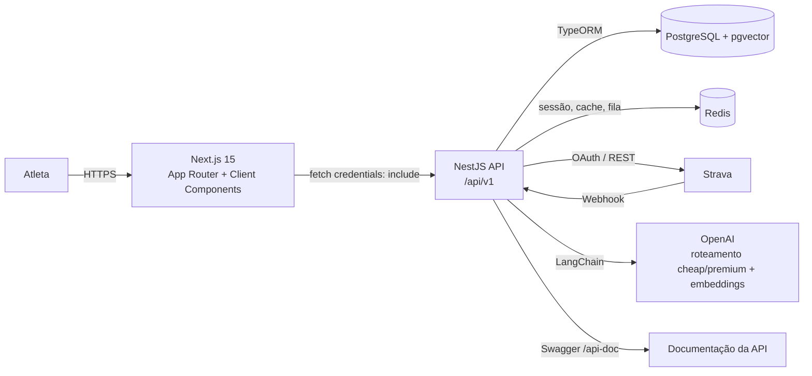
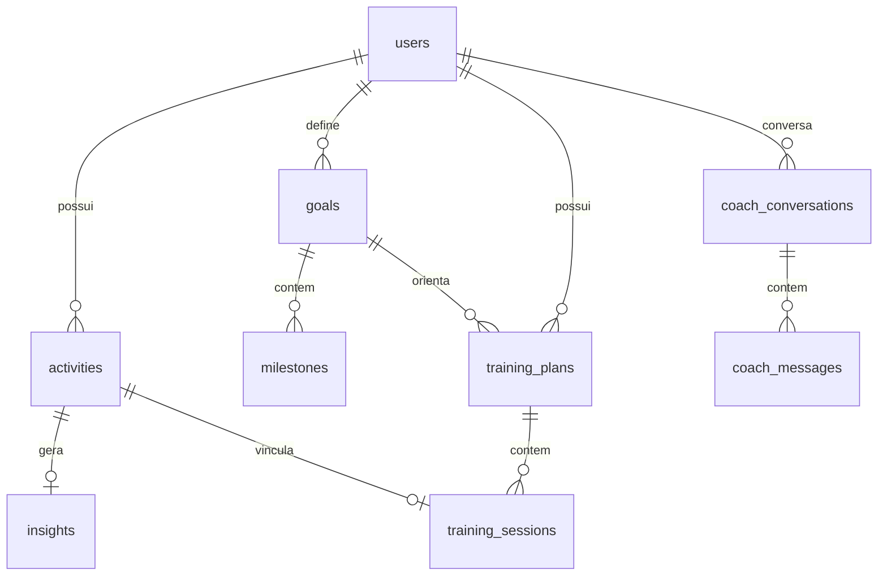

# HLD — Veltra (High-Level Design)

> **Última atualização:** 10/11/2026
> **Escopo:** frontend `veltra-frontend` + backend `veltra-backend`
> **Documento detalhado:** [LLD](./lld.md)
> **Fonte de verdade:** este documento descreve o estado **as-built** do projeto. Se o código divergir, a divergência deve ser corrigida no código ou registrada aqui e no LLD.

---

## 1. Visão geral

O Veltra é uma plataforma de treinamento de corrida que:

1. sincroniza as atividades do atleta a partir do **Strava**;
2. organiza o histórico em atividades, plano semanal, meta e conquistas;
3. usa **IA** para gerar insights por corrida e um coach conversacional;
4. permite que o coach **proponha mudanças** no plano, sempre validadas antes de aplicar;
5. aplica regras de segurança por idade, volume e intensidade.

O produto é dividido em duas aplicações:

| Aplicação | Tecnologia | Papel |
|---|---|---|
| `veltra-frontend` | Next.js 15 (App Router) + React 19 + Tailwind 4 | Interface do corredor (SPA autenticada) |
| `veltra-backend` | NestJS 11 + TypeORM + PostgreSQL/pgvector + Redis | API, persistência, integrações e IA |

> No checkout atual, a raiz versiona o frontend e a documentação; `veltra-backend/` é ignorado no Git da raiz e possui repositório próprio.

---

## 2. Escopo e limites

### Dentro do escopo

- Login via Strava OAuth e sessão httpOnly.
- Sincronização de corridas (webhook e resync manual).
- CRUD de meta, plano de treino e sessões.
- Insights por atividade e feed de insights.
- Chat com o coach (streaming SSE) e negociação de mudanças no plano.
- Analytics semanal, conquistas, melhores tempos e previsões.
- Políticas de saúde por idade e alertas de segurança.

### Fora do escopo (atual)

- App mobile nativo.
- Multiusuário por conta, times, cobrança e assinaturas.
- Treinos de modalidades diferentes de corrida (bike, natação etc.).
- Treinador humano com painel administrativo.
- Busca semântica exposta por API (o embedding é gerado, mas não há endpoint de consulta).

---

## 3. Atores

| Ator | Interação |
|---|---|
| **Atleta** | Autentica com Strava, configura meta/perfil, consulta plano, atividades, análises, conquistas e conversa com o coach. |
| **Strava** | Provedor de OAuth, origem das atividades e emissor de webhooks. |
| **Coach IA (OpenAI)** | Gera insights, análises de plano e respostas do chat. Não persiste dados por conta própria. |
| **Operador/dev** | Mantém os serviços, containers e documentação. |

---

## 4. Arquitetura de alto nível

### Camadas

| Camada | Responsabilidade |
|---|---|
| **Apresentação** | Páginas Next.js, layouts, componentes de UI, design system e hooks de autenticação. |
| **Borda HTTP** | Controllers NestJS, DTOs com `class-validator`, `ValidationPipe`, CORS, cookies e rate limiting. |
| **Domínio** | Services por módulo (planos, metas, insights, coach, saúde, conquistas, analytics). |
| **Persistência** | Entidades TypeORM, repositórios e transações. |
| **Integrações** | Strava (OAuth, API, webhook), OpenAI/LangChain, Redis. |
| **Assíncrono** | Worker interno do webhook Strava consumindo fila Redis. |

### Princípios arquiteturais

- **API stateless**: a sessão vive no Redis e no cookie, não na memória do processo.
- **Escopo por usuário**: toda rota autenticada resolve o `userId` e filtra queries por ele.
- **IA não escreve direto no plano**: o coach apenas propõe; o backend valida e o frontend aplica.
- **Roteamento de modelos por custo**: tarefas simples usam o tier barato; análises complexas, contexto longo, saúde ou negociação de plano usam o tier premium, com escalonamento em caso de parsing inválido.
- **Regras de segurança no servidor**: idade, volume, pace, colisão de dias e estado da sessão.
- **Contrato único de API**: respostas em `snake_case`, convertidas para `camelCase` no client.
- **Datas de semana**: segunda a domingo no fuso local do servidor.

---

## 5. Componentes principais

### 5.1 Frontend

| Área | Rota | Responsabilidade |
|---|---|---|
| Login | `/login` | Entrada com Strava. |
| Dashboard | `/dashboard` | Resumo semanal, progresso, próximo treino, alertas de saúde e últimas corridas. |
| Perfil | `/profile` | Data de nascimento, consentimento de saúde e política de idade. |
| Plano de treino | `/training-plan` | Semanas, sessões, edição, vínculo manual, regeneração e avisos de idade. |
| Atividades | `/activities` | Lista paginada, filtros por período/ano e agrupamento por mês. |
| Detalhe da atividade | `/activities/[id]` | Métricas, voltas, insight do coach e alertas de saúde. |
| Análises | `/analytics` | Cards de distância, ritmo, zonas de FC e elevação. |
| Comparação | `/comparison` | Comparação lado a lado de duas corridas. |
| Meta | `/goal` | Criação/edição de meta, benchmark de 3 km, dias de treino e milestones. |
| Conquistas | `/achievements` | Troféus, melhores tempos e previsões. |
| Coach — insights | `/coach/insights` | Feed de insights com filtro de aderência. |
| Coach — chat | `/coach/chat` | Conversa com streaming, histórico e aplicação de propostas. |

Componentes transversais:

- `(authenticated)/layout.tsx` protege rotas com `AuthProvider` + `AuthGuard`.
- `components/sidebar.tsx` e `components/header.tsx` compõem a navegação.
- `components/ui/*` concentra o design system.
- `lib/api/*` concentra o client HTTP e os módulos por domínio.
- `lib/format.ts`, `lib/training-display.ts` e `lib/achievement-display.ts` concentram formatação e constantes visuais.

### 5.2 Backend

| Módulo | Responsabilidade | Dependências externas |
|---|---|---|
| `auth` | OAuth Strava, sessão, JWT de recuperação, logout. | Strava, Redis, Users |
| `users` | Perfil, data de nascimento, consentimento, tokens Strava. | Strava, Activities |
| `activities` | Persistência, listagem, filtros, detalhe e upsert de corridas. | Insights, AI |
| `strava` | Cliente da API do Strava e subscriptions de webhook. | Strava |
| `strava-webhook` | Fila Redis, processamento de eventos, resync manual e rotação de token. | Redis, Strava, Activities, Training Plans, Insights |
| `training-plans` | Geração e edição de planos, pareamento de atividades, ajuste de volume. | Activities, Goals, AI |
| `goals` | CRUD de metas, milestones e regeneração do plano. | Training Plans |
| `insights` | Insight por atividade, feed e aderência. | AI, Training Plans, Goals |
| `coach` | Conversas, contexto do atleta, streaming e validação de propostas. | AI, Training Plans, Health |
| `analytics` | Estatísticas da semana atual. | Activities |
| `achievements` | Troféus, melhores esforços e previsões. | Activities |
| `health` | Alertas e políticas de segurança por idade. | Activities, Users |
| `ai` | Prompts, roteamento de modelos, chamadas OpenAI/LangChain, limites de tokens e parsing. | OpenAI |
| `redis` | Wrapper de cache, locks e filas. | Redis |

---

## 6. Fluxos principais

### 6.1 Login com Strava

1. O frontend redireciona para `GET /api/v1/auth/strava/connect`.
2. O backend redireciona ao Strava com escopo `read,activity:read_all`.
3. O Strava chama `GET /api/v1/auth/strava/callback?code=...`.
4. O backend troca o código por tokens, cria/atualiza o usuário e importa as atividades.
5. O backend grava a sessão no Redis (`app:session:<uuid>`, TTL 7 dias) e emite:
   - cookie httpOnly `user_session` (sessão);
   - cookie httpOnly `veltra_auth` (JWT de recuperação, 7 dias).
6. O usuário é redirecionado para `/dashboard`.

### 6.2 Ingestão de atividades

**Webhook (principal):**

1. Strava envia evento para `POST /api/v1/strava/webhook`.
2. O evento é deduplicado no Redis (`strava:evt:*`, 1h) e enfileirado em `strava:events`.
3. Um worker interno consome a fila a cada 1,5 s, em lotes de 10, com até 3 tentativas.
4. Eventos de atividade: busca detalhe no Strava, faz upsert, vincula ao treino do plano e gera insight se faltar.
5. Eventos de exclusão: desvincula sessões e remove a atividade.
6. Eventos de atleta com `authorized=false`: limpa tokens do usuário.
7. Falhas persistentes vão para `strava:events:failed`.

**Resync manual:**

- `POST /api/v1/strava/resync` busca atividades dos últimos `days` (padrão 7), faz upsert, tenta parear e gera insights.

### 6.3 Geração do plano de treino

1. A meta ativa dispara `regenerateFromGoal` (criação/edição de meta ou `POST /training-plans/regenerate`).
2. O backend remove planos futuros a partir da semana de início.
3. Monta o **perfil do atleta** (histórico, volume recente, paces, nível, idade, padrão de treino).
4. Calcula **paces** (intervalo, limiar, leve, recuperação, meta) e avalia a meta de tempo.
5. Calcula **volume semanal e longão** por fase (`base`, `build`, `peak`, `taper`), com deload e teto por idade.
6. Seleciona **treinos de qualidade** da biblioteca, ajustados ao histórico.
7. Distribui as sessões na semana respeitando dias de corrida, longão, qualidade e recuperação.
8. Persiste plano + sessões e, em background, enriquece com notas da IA.
9. Faz backfill de atividades recentes para vincular ao novo plano.

### 6.4 Insight por corrida

1. Ao abrir a atividade, o frontend consulta `GET /activities/:id/insight`.
2. Se não existir (ou o atleta pedir), `POST /activities/:id/insight` gera.
3. O backend monta contexto com dados da corrida, treino planejado, aderência, meta, perfil e limites por idade.
4. A IA responde JSON estruturado (`summary`, `performance`, `workoutType`, `plan`, `tips`).
5. O insight é salvo com status `pending`, `completed` ou `failed`.

### 6.5 Coach conversacional e negociação

1. O frontend envia `POST /coach/chat/stream` com `content` e `conversationId` opcional.
2. O backend monta contexto real do atleta (perfil, meta, semanas futuras, alertas) e transmite tokens via SSE.
3. A resposta pode conter um bloco `<proposta>[...]</proposta>` com até 5 mudanças.
4. O backend valida cada proposta:
   - sessão existe e é futura;
   - distância dentro de ±25% (quando já há treino);
   - pace dentro de ±10%;
   - limite por idade;
   - mudança não vazia;
   - nenhuma colisão de dia na semana.
5. O frontend mostra o diff e aplica via `PUT /training-plans/:planId/sessions/batch` ou por sessão.
6. A IA nunca altera o plano diretamente; sem o clique do atleta, nada é salvo.

### 6.6 Analytics e conquistas

- **Analytics semanal**: soma distância, tempo e número de corridas da semana atual (segunda a domingo).
- **Conquistas**: troféus por marcos, distância, consistência e velocidade; melhores tempos por distância; previsões por Riegel com base nos últimos 90 dias.

### 6.7 Roteamento de modelos de IA

- Cada chamada declara uma tarefa (`activity_match`, `activity_insight`, `plan_review`, `coach_reply`, `generic`).
- O `AiModelRouter` decide entre tier **cheap** (`gpt-4o-mini` por padrão) e **premium** (`gpt-4o` por padrão) por heurísticas determinísticas, sem chamada extra à IA.
- Regras:
  - pareamento de atividade e prompts genéricos → cheap;
  - análise de plano → premium (JSON multi-semana persistido no plano);
  - insight de corrida → premium quando há sinal de saúde ou contexto > 6.000 caracteres;
  - chat do coach → premium quando há sinal de saúde, intenção de mudar o plano, contexto > 8.000 caracteres ou histórico > 12 mensagens.
- Se o tier cheap devolver conteúdo que não passa no parsing, a chamada é repetida uma vez no premium (`OPENAI_MODEL_ESCALATION`, padrão ligado).
- Cada tarefa tem teto de tokens de saída; o uso retornado pela OpenAI é registrado em log (`[ai] task=... tier=... usage=...`).
- Modos: `OPENAI_MODEL_ROUTING=auto|cheap|premium` (padrão `auto`). Nomes dos modelos vêm de `OPENAI_MODEL_CHEAP` e `OPENAI_MODEL_PREMIUM`.

### 6.8 Saúde e segurança

- A idade é calculada a partir de `birthDate`.
- A FC máxima prevista usa a fórmula de Tanaka (`208 - 0,7 × idade`).
- Regras de distância por idade definem mínimo recomendado e necessidade de liberação médica.
- Ajustes de plano por idade reduzem volume, longão e número de estímulos fortes.
- O texto inclui disclaimer educativo e orientação para emergências (SAMU 192).

---

## 7. Modelo de dados (visão lógica)

| Entidade | Papel | Chave |
|---|---|---|
| `users` | Atleta, tokens Strava, nascimento e consentimento. | `id` UUID v7; `stravaId` único |
| `activities` | Corrida importada do Strava, incluindo voltas e embedding. | `id` UUID v7; `activityStravaId` único |
| `insights` | Insight da IA por atividade (1:1). | `activityId` único |
| `goals` | Meta ativa com distância, data, benchmark e preferências. | `id` UUID v7 |
| `milestones` | Marcos de 25%, 50% e 75% da meta. | `id` UUID v7 |
| `training_plans` | Plano de uma semana. | `id` UUID v7; `userId`, `goalId` |
| `training_sessions` | Sessão de um dia do plano. | `id` UUID v7; `planId`, `activityId` |
| `coach_conversations` | Conversa do coach. | `id` UUID v7 |
| `coach_messages` | Mensagens e propostas/rejeições da conversa. | `id` UUID v7 |

Detalhes de colunas, índices e relações físicas estão no [LLD](./lld.md#4-modelo-de-dados).

---

## 8. Superfície da API

Prefixo global: `/api/v1`. Swagger em `/api-doc` fora de produção. Rate limit global: 60 requisições por 6 s (bloqueio de 5 s).

| Domínio | Endpoints |
|---|---|
| Auth | `GET /auth/strava/connect`, `GET /auth/strava/callback`, `GET /auth/me`, `POST /auth/logout` |
| Users | `GET /users/me`, `PATCH /users/me` |
| Activities | `POST /activities`, `GET /activities`, `GET /activities/years`, `GET /activities/:id`, `GET /activities/:id/insight`, `POST /activities/:id/insight` |
| Training plans | `GET /training-plans/current`, `GET /training-plans`, `GET /training-plans/pattern`, `GET /training-plans/by-week`, `POST /training-plans/regenerate`, `PUT /training-plans/:planId/sessions/batch`, `PUT /training-plans/:planId/sessions/:sessionId/activity`, `PUT /training-plans/:planId/sessions/:sessionId` |
| Goals | `GET /goals`, `GET /goals/:id`, `POST /goals`, `PUT /goals/:id`, `DELETE /goals/:id` |
| Insights | `GET /insights?limit=` |
| Analytics | `GET /analytics/weekly` |
| Achievements | `GET /achievements` |
| Health | `GET /health/alerts`, `GET /health/policy?distanceKm=` |
| Coach | `GET /coach/chat`, `POST /coach/chat`, `DELETE /coach/chat`, `POST /coach/chat/stream` |
| Strava | `POST /strava/resync`, `GET /strava/webhook`, `POST /strava/webhook`, `GET /strava/subscription`, `POST /strava/subscription`, `DELETE /strava/subscription` |

> Rotas de webhook são públicas por natureza, mas validadas por token. As demais rotas autenticadas usam a sessão e escopam por usuário.

---

## 9. Invariantes arquiteturais

Estas regras não podem ser violadas sem atualização explícita deste HLD e do LLD:

1. **Escopo por usuário**: nenhum endpoint autenticado pode retornar ou alterar dados de outro usuário.
2. **Sessão**: `AuthSessionService.resolveUserId(req)` é a única porta de resolução do usuário autenticado.
3. **Dia único no plano**: cada semana tem no máximo uma sessão por dia; mudanças em lote são transacionais e rejeitam colisões.
4. **Descanso**: sessões `rest` nunca são marcadas como concluídas e têm distância/pace zerados.
5. **Próximo treino**: ignora `rest`, usa `dayOrder` (Seg=0 … Dom=6) e busca a semana seguinte se necessário.
6. **Semana atual**: `analytics/weekly` considera segunda a domingo no horário local.
7. **IA não aplica mudanças**: propostas só viram alteração após validação e ação do atleta.
8. **Segurança por idade**: limites de distância, volume e qualidade são aplicados no servidor.
9. **Contrato de API**: banco/API em `snake_case`; frontend tipado em `camelCase`.
10. **IDs**: novas entidades usam UUID v7 gerado no `@BeforeInsert`.

---

## 10. Requisitos não funcionais

### Segurança

- Cookies `httpOnly`, `secure` em produção e `sameSite` adequado.
- CORS com `credentials: true` limitado a `FRONTEND_URL`.
- Rate limiting global com `@nestjs/throttler`.
- Validação de entrada com `whitelist` e `forbidNonWhitelisted`.
- Nenhum endpoint autenticado sem filtro de usuário.
- Token Strava cacheado no Redis e renovado com lock para evitar corrida.

### Desempenho

- Paginação de atividades.
- Limites de contexto: 20 mensagens de histórico, 10 atividades recentes, 3 planos futuros, 5 propostas.
- Timeouts de IA: 45 s (plano), 30 s (insight), 60 s (coach), 20 s (pareamento).
- Teto de tokens de saída por tarefa: 300 (pareamento), 700 (genérico), 900 (insight), 1.400 (coach), 2.000 (análise de plano).
- Índices únicos em `activities.activityStravaId`, `users.stravaId` e `insights.activityId`.

### Confiabilidade

- Fila Redis com deduplicação, retentativas e lista de falhas.
- Worker interno do webhook com lock de processamento por instância.
- Operações em lote de sessões usando transação.

### Observabilidade

- Logs via `console.error`/`console.warn` em falhas de IA, fila e Strava.
- Uso de tokens das chamadas de IA é registrado em `console.info` (`[ai] task=... tier=... usage=...`).
- **Lacuna:** não há métricas, tracing ou logging estruturado, nem orçamento/limite de gasto por usuário.

### CI/CD

- GitHub Actions por repositório:
  - `veltra-frontend`: `.github/workflows/frontend-ci.yml` executa `npm ci`, `npx tsc --noEmit` e `npm run build` em Node 20.
  - `veltra-backend`: `.github/workflows/backend-ci.yml` executa `npm ci`, lint incremental dos arquivos TS alterados, `npm run build` e Jest (ignorando as 4 suítes de DI conhecidas) em Node 20.
- Pipelines rodam em runner efêmero, sem `npm run dev` e sem os containers locais do usuário.
- O deploy/CD automático ainda depende da definição do alvo de hospedagem e de migrations; produção não pode usar `DB_SYNCHRONIZE=1`.

### UX

- Páginas client-side com estados de carregamento, vazio e erro.
- Textos em pt-BR.
- Design system com tokens semânticos.

---

## 11. Limitações e dívidas conhecidas

| Item | Situação atual |
|---|---|
| Gráficos de Análises | Distância semanal, evolução de ritmo e zonas de FC usam dados estáticos de demonstração; apenas a elevação total é calculada das atividades. |
| Busca semântica | O embedding só é gerado no cadastro manual da atividade (`POST /activities`); importações via webhook/resync usam `upsert` e não geram embedding. Não há endpoint de busca por similaridade. |
| Dimensão do embedding | O modelo `text-embedding-3-small` gera 1536 dimensões; a entidade declara `vector` com `length: 1563` (inconsistência a revisar). |
| Testes do backend | Quatro suítes têm falha pré-existente de DI: `auth.service.spec`, `auth.controller.spec`, `users.service.spec`, `insights.service.spec`. |
| Lint do frontend | Não há configuração de ESLint; `npm run lint` (`next lint`) fica interativo. |
| Lint do backend | O baseline tem erros pré-existentes; o CI faz lint apenas dos arquivos TS alterados. |
| CD/deploy | CI existe, mas o deploy automático ainda depende do alvo de hospedagem e de migrations. |
| Migrations | O projeto não possui migrations versionadas; produção não deve usar `DB_SYNCHRONIZE=1`. |
| Multiusuário/equipe | Não suportado. |
| Outros esportes | Apenas `Run`/`TrailRun`/`VirtualRun` são considerados em fluxos de corrida; o restante é ignorado/removido. |
| Consentimento de saúde | É armazenado e exibido, mas as políticas de idade são aplicadas independentemente do consentimento. |

---

## 12. Manutenção deste documento

- O HLD descreve **intenção arquitetural e fluxos de alto nível**.
- O LLD descreve **implementação, algoritmos, contratos e detalhes de código**.
- Mudanças que afetem arquitetura, modelo de dados, API pública ou invariantes devem atualizar **HLD e LLD na mesma tarefa**.
- Use os comandos `/hld` e `/lld` para revisar/atualizar os documentos a partir do código.
- O agente deve tratar estes documentos como contrato: se precisar divergir, atualize-os e explique o motivo.

---

## 13. Referências

- [LLD — Low-Level Design](./lld.md)
- [README do frontend](../veltra-frontend/README.md)
- [README do backend](../veltra-backend/README.md)
- [AGENTS.md](../AGENTS.md)
